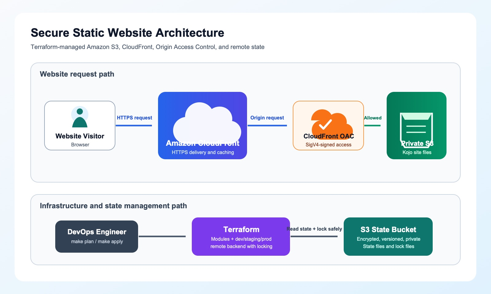
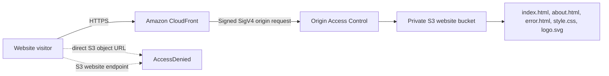
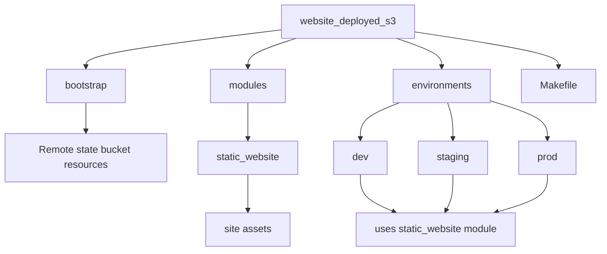
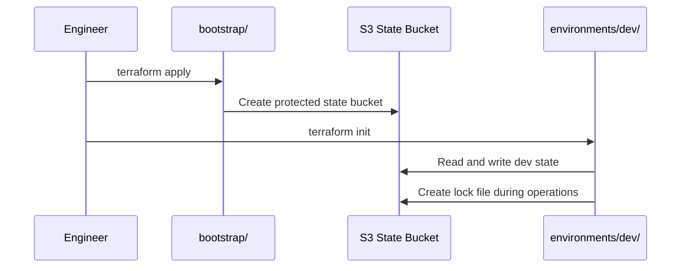
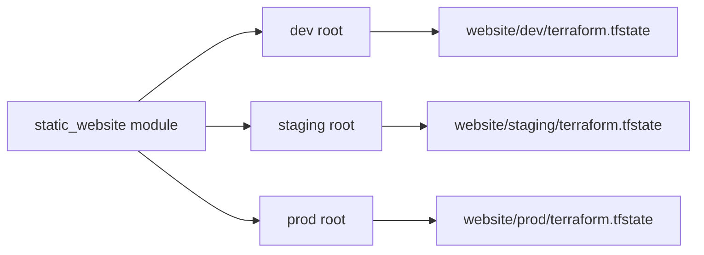

# Class Study Guide: Secure Static Website with Terraform

## Learning Goal

By the end of this lesson, junior DevOps engineers should be able to explain and implement a secure static website on AWS using:

- Terraform Infrastructure as Code (IaC)
- Amazon S3 for private object storage
- Amazon CloudFront for global HTTPS delivery
- CloudFront Origin Access Control (OAC) to keep the S3 bucket private
- An S3 remote backend with Terraform state locking
- Separate `dev`, `staging`, and `prod` environments
- A Makefile for safe, repeatable commands

This project deliberately does **not** use a custom domain, Route 53, or ACM certificate. CloudFront supplies a default `*.cloudfront.net` HTTPS URL.

## 1. The Problem We Are Solving

A static website consists of files such as:

- HTML pages
- CSS stylesheets
- Images or logos

The easy but unsafe approach is to make an S3 bucket public. Instead, this project follows a more secure production-style model:

1. Store website files in a private S3 bucket.
2. Put CloudFront in front of that bucket.
3. Let only the CloudFront distribution read the files.
4. Let public visitors access only the CloudFront URL over HTTPS.

## 2. Architecture



The JPEG diagram above works in Markdown previews that do not support Mermaid.



### What Each Component Does

| Component | Responsibility |
|---|---|
| Browser visitor | Requests the public website URL |
| CloudFront | Caches and delivers content globally; redirects HTTP to HTTPS |
| OAC | Signs CloudFront requests to S3 using SigV4 |
| Private S3 bucket | Stores the website files but does not allow public reads |
| S3 bucket policy | Allows `s3:GetObject` only for this CloudFront distribution |

## 3. Why We Use CloudFront Without a Custom Domain

CloudFront automatically assigns a hostname like:

```text
https://d123example.cloudfront.net
```

This is enough for a secure HTTPS website because CloudFront provides its default TLS certificate for the `cloudfront.net` domain.

Benefits for this training project:

- No domain purchase is required.
- No Route 53 hosted zone is required.
- No ACM certificate is required.
- HTTPS still works.

A custom domain can be added later by creating Route 53 records and an ACM certificate in `us-east-1`.

## 4. Terraform Folder Structure



```text
website_deployed_s3/
├── bootstrap/                     # Creates the remote Terraform state bucket once
├── modules/
│   └── static_website/            # Reusable S3 + CloudFront implementation
│       └── site/                  # Kojo's HTML, CSS, and SVG files
├── environments/
│   ├── dev/                       # Development root module and remote state key
│   ├── staging/                   # Staging root module and remote state key
│   └── prod/                      # Production root module and remote state key
├── Makefile                       # Short commands for Terraform tasks
├── .gitignore                     # Protects state, plans, and local variables
└── CLASS_STUDY_GUIDE.md           # This teaching document
```

## 5. Terraform Fundamentals Used

### Provider

A provider is the plugin Terraform uses to communicate with a platform. This project uses the AWS provider:

```hcl
provider "aws" {
  region  = var.aws_region
  profile = var.aws_profile
}
```

The provider reads the `spomega` AWS CLI profile and deploys to `eu-central-1`.

### Resource

A resource is something Terraform creates or manages:

```hcl
resource "aws_s3_bucket" "website" {
  bucket = local.bucket_name
}
```

### Data Source

A data source reads existing information instead of creating something:

```hcl
data "aws_caller_identity" "current" {}
```

We use the AWS account ID to make the website bucket name globally unique.

### Variable

A variable makes Terraform reusable:

```hcl
variable "environment" {
  type    = string
  default = "dev"
}
```

The same module can be called for `dev`, `staging`, or `prod`.

### Output

An output shows useful values after apply:

```hcl
output "cloudfront_url" {
  value = "https://${aws_cloudfront_distribution.website.domain_name}"
}
```

## 6. Step One: Bootstrap the Remote Backend

Terraform normally stores state locally in `terraform.tfstate`. Local state is not suitable for a team because:

- It can be lost if a laptop fails.
- It is hard for multiple engineers to share safely.
- Two users could apply conflicting changes simultaneously.

We solve this by creating a dedicated S3 state bucket first.



### Bootstrap Bucket Controls

The bootstrap configuration creates:

| Control | Why it matters |
|---|---|
| Versioning | Helps recover from accidental state changes or deletion |
| SSE-S3 encryption | Encrypts Terraform state at rest |
| Block Public Access | Prevents accidental public state exposure |
| Bucket owner enforced | Disables ACL-based access |
| TLS-only bucket policy | Rejects insecure HTTP requests |
| `prevent_destroy = true` | Stops accidental removal of the state bucket |

The state bucket is not the website bucket. It has a completely different purpose.

### Chicken-and-Egg Problem

Terraform cannot use an S3 backend until the backend bucket already exists.

That is why `bootstrap/` initially uses local state. After it creates the backend bucket, environment folders can use remote state.

## 7. Terraform Remote State and Locking

Each environment has a backend block:

```hcl
backend "s3" {
  key          = "website/dev/terraform.tfstate"
  region       = "eu-central-1"
  use_lockfile = true
  encrypt      = true
}
```

The bucket name is supplied during `terraform init` because backend configuration cannot use normal Terraform variables.

### State Keys

| Environment | Remote state object |
|---|---|
| Dev | `website/dev/terraform.tfstate` |
| Staging | `website/staging/terraform.tfstate` |
| Prod | `website/prod/terraform.tfstate` |

`use_lockfile = true` prevents competing Terraform operations from writing state at the same time.

## 8. Step Two: Build a Reusable Module

The reusable module is in:

```text
modules/static_website/
```

Instead of copying S3 and CloudFront code into every environment, each environment calls this one module:

```hcl
module "website" {
  source = "../../modules/static_website"

  project_name = var.project_name
  environment  = var.environment
  aws_region   = var.aws_region
  common_tags  = var.common_tags
}
```

### Why Modules Matter

- Consistency: every environment uses the same infrastructure pattern.
- Reuse: one change can be reused across environments.
- Review: infrastructure logic is centralized.
- Safety: fewer copy-and-paste mistakes.

## 9. Step Three: Create a Private S3 Website Bucket

The module creates a bucket name from the project name, environment, AWS account ID, and region:

```hcl
bucket_name = lower(
  "${var.project_name}-${var.environment}-${data.aws_caller_identity.current.account_id}-${var.aws_region}"
)
```

Example:

```text
kojo-profile-dev-509157248746-eu-central-1
```

### Important Bucket Controls

```hcl
block_public_acls       = true
block_public_policy     = true
ignore_public_acls      = true
restrict_public_buckets = true
```

These controls protect the bucket from becoming public by mistake.

The website bucket also uses:

- Versioning
- Server-side encryption (`AES256`)
- Bucket owner enforced ownership
- HTTPS-only direct S3 access

## 10. Static Website Hosting vs Secure Content Delivery

The project configures:

```hcl
index_document {
  suffix = "index.html"
}

error_document {
  key = "error.html"
}
```

This satisfies the static website configuration requirement. However, the S3 website endpoint is **not** the CloudFront origin.

### Why Not Use the S3 Website Endpoint?

CloudFront OAC works with the S3 REST endpoint:

```hcl
domain_name = aws_s3_bucket.website.bucket_regional_domain_name
```

It does not work with an S3 website endpoint. Using the REST endpoint lets CloudFront authenticate to a private S3 bucket.

| URL | Expected result |
|---|---|
| CloudFront URL | Website loads over HTTPS |
| Direct S3 object URL | `AccessDenied` |
| S3 website endpoint | `AccessDenied` |

This is the desired security result.

## 11. Step Four: Upload the Website Files

Terraform uploads Kojo's website assets:

```text
index.html
about.html
error.html
style.css
logo.svg
```

Terraform uses a map to assign correct content types:

```hcl
"index.html" = {
  content_type = "text/html; charset=utf-8"
}
```

Why content types matter:

- Browsers need `text/html` for pages.
- Browsers need `text/css` for stylesheets.
- Browsers need `image/svg+xml` for SVG images.

Incorrect content types can cause a browser to download a file instead of rendering it.

## 12. Step Five: Create CloudFront and OAC

OAC is configured as:

```hcl
resource "aws_cloudfront_origin_access_control" "website" {
  origin_access_control_origin_type = "s3"
  signing_behavior                  = "always"
  signing_protocol                  = "sigv4"
}
```

### What OAC Does

1. A user asks CloudFront for `index.html`.
2. CloudFront makes a signed request to S3.
3. The S3 policy checks the CloudFront distribution ARN.
4. S3 returns the file to CloudFront.
5. CloudFront returns the file to the user.

The CloudFront distribution also:

```hcl
default_root_object = "index.html"
viewer_protocol_policy = "redirect-to-https"
price_class = "PriceClass_100"
```

| Setting | Explanation |
|---|---|
| Default root object | Shows `index.html` at the bare CloudFront URL |
| Redirect to HTTPS | Redirects visitors who use HTTP to HTTPS |
| Price class 100 | Uses a lower-cost CloudFront edge-location set for the learning project |
| Compress | Compresses eligible content before delivery |
| CachingOptimized | Uses AWS's managed cache policy |
| SecurityHeadersPolicy | Adds useful browser security headers |

## 13. Step Six: Allow Only CloudFront in the Bucket Policy

The S3 bucket policy gives read access to the CloudFront service principal:

```hcl
Principal = {
  Service = "cloudfront.amazonaws.com"
}
```

It also restricts the allow statement to the exact CloudFront distribution:

```hcl
Condition = {
  StringEquals = {
    "AWS:SourceArn" = aws_cloudfront_distribution.website.arn
  }
}
```

This is an important least-privilege control. It means another CloudFront distribution cannot use this bucket policy.

The policy also includes a TLS deny statement:

```hcl
"aws:SecureTransport" = "false"
```

That denies insecure direct S3 requests over HTTP.

## 14. Step Seven: Use Separate Environments

Each environment has:

- Its own Terraform state key
- Its own website bucket
- Its own CloudFront distribution
- Its own values and tags



### Environment Strategy

| Environment | Typical purpose |
|---|---|
| Dev | Fast learning, experimentation, and early testing |
| Staging | Final validation before production |
| Prod | Public, stable workload |

Never run production commands accidentally from the development directory. The `ENV` argument in the Makefile makes the target clear.

## 15. Step Eight: Use the Makefile

The Makefile is a shortcut layer over Terraform commands. It reduces long repeated commands and provides guardrails.

### Helpful Commands

```bash
make help
```

Bootstrap the remote state bucket:

```bash
make bootstrap-plan
make bootstrap-apply
```

Initialize and deploy development:

```bash
make init ENV=dev
make plan ENV=dev
make apply ENV=dev
```

Get the CloudFront URL:

```bash
make url ENV=dev
```

Use a different environment:

```bash
make plan ENV=staging
make plan ENV=prod
```

### Saved Plan Workflow

The Makefile does not apply an unreviewed plan:

1. `make plan ENV=dev` creates `plan.tfplan`.
2. Review the Terraform output.
3. `make apply ENV=dev` applies that exact file.
4. The Makefile removes the plan file after a successful apply.

The same safety pattern is used for destroy:

```bash
make destroy-plan ENV=dev
make destroy ENV=dev
```

## 16. Important Troubleshooting Lesson: Saved Plans Keep Old Values

During this project, an S3 bucket plan failed because an earlier saved plan contained an invalid bucket value.

Key rule:

> Terraform applies the values saved in a plan file. It does not reread `terraform.tfvars` during `terraform apply plan.tfplan`.

When variables change:

```bash
make bootstrap-plan
make bootstrap-apply
```

Do not reuse an older plan file after changing variables.

## 17. Verification Checklist

After CloudFront finishes deploying:

1. Get the website URL:

   ```bash
   make url ENV=dev
   ```

2. Open the URL in a browser and verify it loads over HTTPS.
3. Confirm the bare CloudFront URL loads `index.html`.
4. Confirm `/about.html` loads.
5. Confirm a non-existent page displays the custom error page.
6. Confirm the direct S3 object URL returns `AccessDenied`.
7. Confirm the S3 website endpoint returns `AccessDenied`.
8. Confirm S3 Block Public Access remains enabled.

## 18. Cleanup

Destroy the environment only after reviewing the destroy plan:

```bash
make destroy-plan ENV=dev
make destroy ENV=dev
```

Do not destroy the bootstrap state bucket during ordinary application cleanup. It contains the remote state needed to manage environments and uses `prevent_destroy = true`.

## 19. Key Terms for Learners

| Term | Meaning |
|---|---|
| IaC | Defining infrastructure in version-controlled files |
| Terraform state | Terraform's record of resources it manages |
| Remote backend | Central remote location for Terraform state |
| State lock | A mechanism that prevents simultaneous Terraform updates |
| Module | Reusable Terraform configuration |
| OAC | CloudFront mechanism for authenticated S3 origin access |
| SigV4 | AWS request-signing protocol |
| Origin | The source CloudFront retrieves content from |
| S3 REST endpoint | S3 API endpoint used by secure CloudFront OAC access |
| S3 website endpoint | Static website endpoint that cannot use OAC |
| Least privilege | Granting only the minimum access required |

## 20. Discussion Questions

1. Why is the state bucket separate from the website bucket?
2. Why must the bootstrap backend be created before environment state can be remote?
3. Why does CloudFront use the S3 REST endpoint instead of the S3 website endpoint?
4. What security risk would a public-read S3 policy introduce?
5. How does `AWS:SourceArn` improve the CloudFront bucket policy?
6. Why are `dev`, `staging`, and `prod` states separate?
7. What happens if two engineers run Terraform at the same time without state locking?
8. Why must a new plan be created after changing `terraform.tfvars`?
9. What does `force_destroy = true` do, and why should it be treated carefully?
10. Which additional services are needed before using a custom domain?
